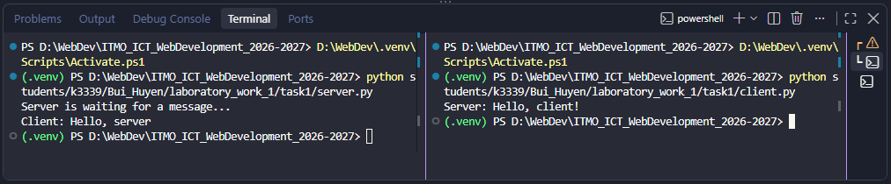
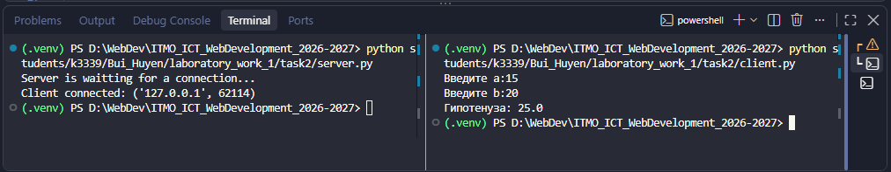
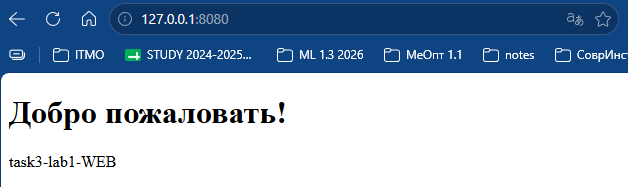
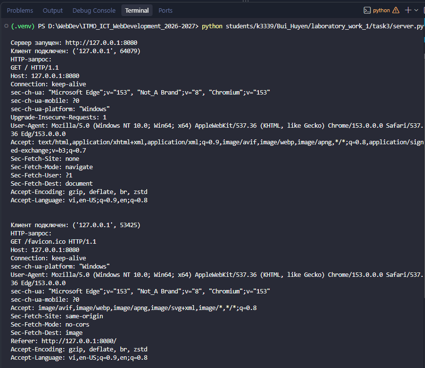
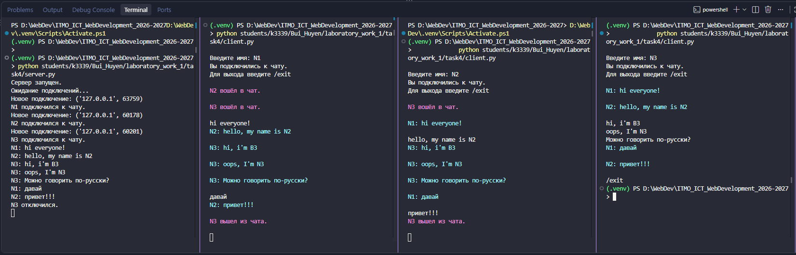
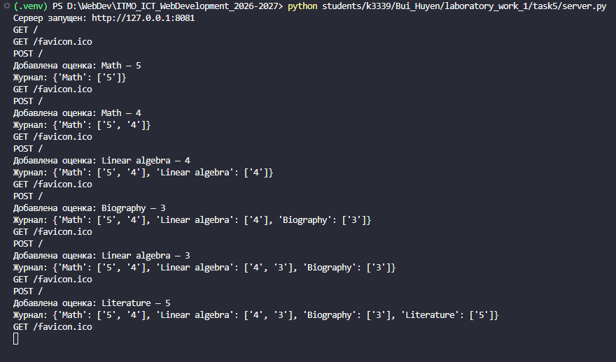
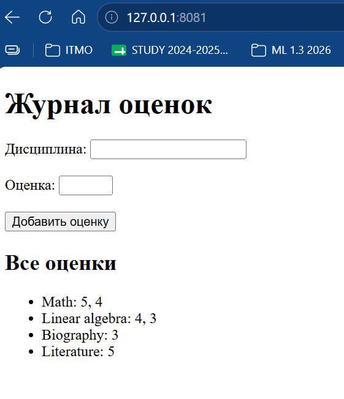

# Отчёт лабораторной работы №1

## Цель работы
Понять принципы межсокетного взаимодействтия в вебе. Научиться реализовывать базовую архитектуру клиент-сервер.

## Задание 1. Обмен сообщениями по UDP
### Описание протокола
В первом задании используется протокол UDP. Он не требует предварительного установления соединения между клиентом и сервером. Клиент отправляет сообщение на IP-адрес и порт сервера, а сервер получает сообщение вместе с адресом отправителя.

В программе сервер ожидает сообщение `Hello, server!`, выводит его в терминал и отправляет клиенту ответ `Hello, client!`.
### Реализация
Сервер создаёт UDP-сокет и привязывает его к адресу `127.0.0.1` и порту `5000`. После этого он ожидает сообщение от клиента с помощью `recvfrom()`. Полученное сообщение декодируется и выводится в терминал.

Клиент отправляет серверу сообщение `Hello, server!` с помощью `sendto()`. Сервер получает адрес клиента и отправляет по этому адресу ответ `Hello, client!`. После получения ответа клиент выводит его в терминал.
### Код сервера
```python
import socket

HOST = "127.0.0.1"
PORT = 5000

# UDP сокет
server_socket = socket.socket(socket.AF_INET, socket.SOCK_DGRAM)

# Привязываем сокет к адресу и порту
server_socket.bind((HOST, PORT))

print("Server is waiting for a message...")

# Получаем данные
data, client_address = server_socket.recvfrom(1024)
message = data.decode()
print('Client:', message)

# Ответим клиенту.
response = "Hello, client!"
server_socket.sendto(response.encode(), client_address)
server_socket.close()
```

### Код клиента
```python
import socket

HOST = '127.0.0.1'
PORT = 5000

# UDP сокет
client_socket = socket.socket(socket.AF_INET, socket.SOCK_DGRAM)
message = 'Hello, server!'

client_socket.sendto(message.encode(), (HOST, PORT))

# Получаем результат от сервера
data, server_address = client_socket.recvfrom(1024)
response = data.decode()
print("Server:", response)

client_socket.close()
```

### Результат работы
После запуска сервера клиент отправляет ему сообщение. Сервер получает сообщение и отправляет ответ клиенту.


## Задание 2. Вычисление по теореме Пифагора через TCP
### Описание протокола
В данном задании используется протокол **TCP (Transmission Control Protocol)**. В отличие от UDP, перед передачей данных TCP устанавливает соединение между клиентом и сервером.

Сервер создаёт сокет, привязывает его к определённому IP-адресу и порту и ожидает подключения клиента. После установления соединения клиент и сервер могут обмениваться данными с помощью методов `send()` и `recv()`.

### Реализация
Сервер создаёт TCP-сокет и привязывает его к адресу `127.0.0.1:5001` и переходит в режим ожидания подключений. После подключения клиента метод `accept()` создаёт отдельный сокет для обмена данными с ним.

Клиент вводит длины двух катетов `a` и `b`, объединяет их в одну строку и отправляет серверу. Сервер получает данные, преобразует значения в числа и вычисляет длину гипотенузы по формуле: $ c = \sqrt{a^2 + b^2} $

Вычисление выполняется на стороне сервера. Полученный результат преобразуется в строку и отправляется обратно клиенту, после чего клиент выводит его в терминале.

Схема взаимодействия:

```text
Клиент                         Сервер
   |                              |
   |------ подключение ---------->|
   |                              |
   |------ a, b ----------------->|
   |                              |
   |                     вычисление c
   |                              |
   |<--------- c -----------------|
   |                              |
вывод результата
```

### Код сервера
```python
import socket

HOST = "127.0.0.1"
PORT = 5001

# Создаем TCP сокет
server_socket = socket.socket(socket.AF_INET, socket.SOCK_STREAM)

# Привязываем сокет к адресу и порту
server_socket.bind((HOST, PORT))

# Начинаем прослушивание подключений
server_socket.listen()
print('Server is waitting for a connection...')

# Принимаем подключение клиента
connection, client_address = server_socket.accept()
print('Client connected:', client_address)

# Получаем данные
data = connection.recv(1024)
message = data.decode()

# Вычисляем гипотенузу
a, b = map(float, message.split())
c = (a**2 + b**2)**0.5

# Отправляем результат
connection.send(str(c).encode())

connection.close()
server_socket.close()
```

### Код клиента
```python
import socket

HOST = '127.0.0.1'
PORT = 5001

# Создаем TCP сокет
client_socket = socket.socket(socket.AF_INET, socket.SOCK_STREAM)
client_socket.connect((HOST, PORT))

# Подключаемся к серверу
a = float(input('Введите а:'))
b = float(input('Введите b:'))

# Вводим длины катетов
message = f'{a} {b}'
client_socket.send(message.encode())

# Получаем результат от сервера
data = client_socket.recv(1024)
result = data.decode()
print('Гипотенуза:', result)

client_socket.close()
```

### Результат работы
Полученный результат соответствует теореме Пифагора:



## Задание 3. Раздача HTML-страницы по HTTP
### Описание протокола
В данном задании используется протокол **HTTP (HyperText Transfer Protocol)**, который работает поверх TCP. HTTP используется для обмена данными между клиентом и сервером. В роли клиента в данной работе выступает браузер.

При открытии страницы браузер устанавливает TCP-соединение с сервером и отправляет HTTP-запрос. Например:

```text
GET / HTTP/1.1
Host: 127.0.0.1:8080
```

Сервер обрабатывает запрос и формирует HTTP-ответ. Ответ состоит из строки состояния, заголовков, пустой строки и тела сообщения с HTML-содержимым.

В данной работе сервер возвращает статус `200 OK` и HTML-страницу из файла `index.html`.

### Реализация
Сервер создаёт TCP-сокет и привязывает его к адресу `127.0.0.1` и порту `8080`. После вызова `listen()` сервер ожидает подключения браузера. Для обработки нескольких последовательных запросов ожидание подключений выполняется в цикле.

После подключения браузера сервер получает HTTP-запрос и выводит его в терминал. Затем содержимое файла `index.html` считывается и кодируется.

Для отправки страницы формируется HTTP-ответ со статусом `200 OK`. В заголовках указываются тип содержимого `text/html`, кодировка UTF-8, размер тела ответа `Content-Length` и закрытие соединения после передачи данных.

Заголовки и HTML-страница объединяются в один ответ и отправляются браузеру с помощью `sendall()`. После отправки текущее соединение закрывается, но сервер продолжает работать и может принять следующий запрос.

Схема взаимодействия:

```text
Браузер                         Сервер
   |                               |
   |------ TCP-соединение -------->|
   |                               |
   |------ HTTP GET/ ------------->|
   |                               |
   |                     чтение index.html
   |                     формирование ответа
   |                               |
   |<----- HTTP 200 OK + HTML -----|
   |                               |
отображение страницы
```

### Код сервера
```python
import socket
from pathlib import Path

HOST = "127.0.0.1"
PORT = 8080

server_socket = socket.socket(socket.AF_INET, socket.SOCK_STREAM)

server_socket.bind((HOST, PORT))
server_socket.listen()

print(f"Сервер запущен: http://{HOST}:{PORT}")

while True:
    connection, client_address = server_socket.accept()

    print("Клиент подключен:", client_address)

    request = connection.recv(4096)

    print("HTTP-запрос:")
    print(request.decode("utf-8", errors="ignore"))

    html_path = Path(__file__).parent / "index.html"

    with open(html_path, "r", encoding="utf-8") as file:
        html = file.read()

    html_bytes = html.encode("utf-8")

    headers = (
        "HTTP/1.1 200 OK\r\n"
        "Content-Type: text/html; charset=utf-8\r\n"
        f"Content-Length: {len(html_bytes)}\r\n"
        "Connection: close\r\n"
        "\r\n"
    )

    response = headers.encode("utf-8") + html_bytes

    connection.sendall(response)
    connection.close()
```
### HTML-страница
```html
<!DOCTYPE html>
<html lang ="ru">
<head>
    <meta charset='UTF-8'>
    <title>Лабораторная работа №1</title>
</head>
<body>
    <h1>Добро пожаловать!</h1>
    <p>task3-lab1-WEB</p>
</body>
</html>
```

### Результат работы
В ответ сервер отправляет содержимое файла `index.html`, после чего браузер отображает полученную HTML-страницу.



Пример полученного HTTP-запроса в терминале:



Первый запрос GET / - это запрос самой HTML-страницы. Второй запрос GET /favicon.ico браузер отправляет автоматически, чтобы получить иконку сайта.

## Задание 4. Чат на сокетах
### Описание протокола
Для реализации чата используется протокол **TCP**. Он обеспечивает установление постоянного соединения между сервером и каждым клиентом и позволяет передавать сообщения в обе стороны.

В отличие от предыдущих заданий, сервер должен одновременно работать с несколькими клиентами. Поэтому для обработки подключений используется многопоточность. Каждый подключённый пользователь обслуживается в отдельном потоке, благодаря чему сервер может получать сообщения от нескольких клиентов независимо друг от друга.

### Реализация
Сервер создаёт TCP-сокет и ожидает подключения клиентов на порту `5002`. После каждого нового подключения создаётся отдельный поток с помощью `threading.Thread()`, в котором выполняется функция `handle_client()`.

При подключении клиент сначала отправляет своё имя. Активные пользователи хранятся на сервере в словаре `clients`, где сокету клиента соответствует его имя. Когда сервер получает сообщение, функция `broadcast()` отправляет его всем подключённым пользователям, кроме отправителя.

На стороне клиента также используется отдельный поток. Он постоянно ожидает входящие сообщения от сервера, в то время как основной поток позволяет пользователю вводить и отправлять свои сообщения. Благодаря этому получение и отправка сообщений могут выполняться независимо.

Для завершения работы пользователь может ввести команду `/exit`. После этого соединение закрывается, пользователь удаляется из списка активных клиентов, а остальные участники получают сообщение о его выходе. Для удобства обычные сообщения и системные уведомления отображаются разными цветами с помощью ANSI-кодов.

### Код сервера
```python
import socket
import threading

HOST = '127.0.0.1'
PORT = 5002

clients = {}

# Отправка сообщения
def broadcast(message, sender):
    for client in clients:
        if client != sender:
            client.send(message.encode())

# Обработка отдельного клиента
def handle_client(connection):
    username = connection.recv(1024).decode()

    clients[connection] = username
    print(f'{username} подключился к чату.')

    broadcast(f'{username} вошёл в чат.', connection)

    while True:
        try:
            message = connection.recv(1024).decode()
            if not message or message == '/exit':
                break

            print(f'{username}: {message}')

            broadcast(f'{username}: {message}', connection)

        except:
            break

    del clients[connection]

    connection.close()
    print(f'{username} отключился.')

    broadcast(f'{username} вышел из чата.', connection)

# Создаем tcp сокет
server_socket = socket.socket(socket.AF_INET, socket.SOCK_STREAM)

server_socket.bind((HOST, PORT))
server_socket.listen()

print('Сервер запущен.')
print('Ожидание подключений...')

while True:
    connection, client_address = server_socket.accept()
    print('Новое подключение:', client_address)

    thread = threading.Thread(target=handle_client, args=(connection,))

    thread.start()
```

### Код клиента
```python
import socket
import threading

HOST = '127.0.0.1'
PORT = 5002

# Цвета для вывода в терминале
CYAN = "\033[96m"
PINK = "\033[95m"
RESET = "\033[0m"

def receive_messages():
    while True:
        try:
            message = client_socket.recv(1024).decode()

            if not message:
                break

            elif "вошёл в чат." in message or "вышел из чата." in message:
                print(f"{PINK}{message}{RESET}\n")

            else:
                print(f"{CYAN}{message}{RESET}\n")    

        except OSError:
            break

client_socket = socket.socket(socket.AF_INET, socket.SOCK_STREAM)

client_socket.connect((HOST, PORT))

username = input('\nВведите имя: ')
client_socket.send(username.encode())

print('Вы подключились к чату.')
print('Для выхода введите /exit\n')

receive_thread = threading.Thread(
    target=receive_messages,
    daemon=True
)

receive_thread.start()

while True:
    message = input()

    if not message.strip():
        continue

    client_socket.send(message.encode())

    if message == '/exit':
        break

client_socket.close()
```

### Результат работы
Для проверки работы чата были одновременно запущены сервер и несколько экземпляров одного клиентского приложения. Каждый клиент подключался к серверу под своим именем. После подключения нового пользователя сервер сохраняет его имя и сообщает остальным участникам о входе в чат. Сообщение, отправленное одним пользователем, появляется у остальных подключённых клиентов с указанием имени отправителя.


## Задание 5. Веб-сервер GET/POST
### Описание
В данном задании реализован простой веб-сервер с использованием библиотеки `socket`. Сервер обрабатывает HTTP-запросы методов **GET** и **POST**.

Метод `GET` используется для получения HTML-страницы с формой и списком сохранённых оценок. Метод `POST` используется для передачи серверу данных из формы: названия дисциплины и оценки.

В роли клиента выступает браузер. Данные передаются по протоколу HTTP поверх TCP.

### Реализация GET и POST
Сервер создаёт TCP-сокет и принимает подключения на порту `8081`. После получения HTTP-запроса сервер разделяет заголовки и тело запроса, а по первой строке определяет HTTP-метод и путь.

При `POST`-запросе сервер получает размер тела из заголовка и считывает данные формы. Поскольку браузер передаёт их в формате `application/x-www-form-urlencoded`, для разбора используется функция `parse_qs()`.

При `GET`-запросе сервер формирует HTML-страницу, содержащую форму для добавления новой оценки и все ранее сохранённые данные. После `POST`-запроса новая оценка сначала добавляется в словарь, после чего сервер также формирует обновлённую страницу и отправляет её браузеру.

### Структура хранения данных
Для хранения данных используется словарь `grades`. Ключом словаря является название дисциплины, а значением - список оценок по этой дисциплине.

Например:
```python
grades = {
    "Math": ["5", "4", "3"],
    "Physics": ["5"],
    "Literature": ["4"]
}
```

При добавлении новой оценки сервер сначала проверяет, существует ли такая дисциплина в словаре. Если дисциплины ещё нет, для неё создаётся пустой список. После этого новая оценка добавляется в соответствующий список:

```python
if discipline not in grades:
    grades[discipline] = []

grades[discipline].append(grade)
```

Данные хранятся в оперативной памяти во время работы сервера, поэтому после его остановки словарь очищается. Использование базы данных в данном задании не требуется.

### Код сервера
```python
import socket
from urllib.parse import parse_qs

HOST = "127.0.0.1"
PORT = 8081

# Хранилище оценок
grades = {}

def create_html():
    grades_html = ''

    # Формируем список оценок по дисциплинам
    for discipline, discipline_grades in grades.items():
        grades_html += (
            f'<li>{discipline}: '
            f'{', '.join(map(str, discipline_grades))}</li>'
        )

    html = f"""
    <!DOCTYPE html>
    <html lang = ru>
    <head>
        <meta charset='UTF-8'>
        <title>Журнал оценок</title>
    </head>
    
    <body>
        <h1>Журнал оценок</h1>
        <form method='POST' action='/'>
            <label>Дисциплина:</label>
            <input type='text' name='discipline' required>

            <br><br>

            <label>Оценка:</label>
            <input type='number' name='grade' min='1' max='5' required>

            <br><br>

            <button type='submit'>Добавить оценку</button>
        </form>

        <h2>Все оценки</h2>

        <ul>
            {grades_html}
        </ul>

    </body>
    </html> 
    """
    return html

def send_response(connection, html):
    body = html.encode("utf-8")

    headers = (
        "HTTP/1.1 200 OK\r\n"
        "Content-Type: text/html; charset=utf-8\r\n"
        f"Content-Length: {len(body)}\r\n"
        "Connection: close\r\n"
        "\r\n"
    )

    response = headers.encode("utf-8") + body

    connection.sendall(response)


server_socket = socket.socket(socket.AF_INET, socket.SOCK_STREAM)

server_socket.bind((HOST, PORT))
server_socket.listen()

print(f"Сервер запущен: http://{HOST}:{PORT}")

while True:
    connection, client_address = server_socket.accept()

    try:
        # Получаем первую часть HTTP-запроса
        request = connection.recv(4096)

        if not request:
            continue

        # Разделяем заголовки и тело запроса
        header_data, separator, body = request.partition(b"\r\n\r\n")

        headers_text = header_data.decode("utf-8")
        request_line = headers_text.split("\r\n")[0]

        method, path, version = request_line.split()

        print(f"{method} {path}")

        # Обрабатываем POST-запрос
        if method == "POST":

            # Находим Content-Length
            content_length = 0

            for line in headers_text.split("\r\n"):
                if line.lower().startswith("content-length:"):
                    content_length = int(line.split(":", 1)[1].strip())
                    break

            # Если тело пришло не полностью, получаем оставшуюся часть
            while len(body) < content_length:
                body += connection.recv(
                    content_length - len(body)
                )

            body_text = body.decode("utf-8")
            form_data = parse_qs(body_text)
            discipline = form_data.get("discipline", [""])[0].strip()
            grade = form_data.get("grade", [""])[0].strip()

            if discipline and grade:
                if discipline not in grades:
                    grades[discipline] = []

                grades[discipline].append(grade)

                print(f"Добавлена оценка: {discipline} — {grade}")
                print("Журнал:", grades)

        # Создаём актуальную HTML-страницу
        html = create_html()

        # Отправляем страницу браузеру
        send_response(connection, html)

    finally:
        connection.close()
```

### Результат работы
При добавлении нескольких оценок одной дисциплины они сохраняются в одном списке. 



На HTML-странице эти данные отображаются сгруппированными по дисциплинам:



## Вывод
Лабораторная работа позволила на практике рассмотреть основные принципы сетевого взаимодействия и работу сокетов в Python. Были изучены особенности UDP и TCP: от простой передачи сообщений без установления соединения до постоянного TCP-соединения между клиентом и сервером.

Работа с HTTP показала, как браузер взаимодействует с сервером на более низком уровне: отправляет запрос, получает заголовки и HTML-содержимое в ответ. Обработка GET- и POST-запросов также позволила проследить передачу данных от HTML-формы на сервер и их последующее отображение на странице.

Отдельное внимание было уделено одновременной работе с несколькими подключениями. Использование потоков в чате позволило независимо принимать сообщения от разных клиентов и передавать их другим участникам. Для хранения оценок была применена структура на основе словаря, обеспечивающая их группировку по дисциплинам.

В результате были освоены основные этапы работы с сокетами: создание соединения, передача и получение данных, обработка HTTP-запросов и организация взаимодействия с несколькими клиентами. Полученные результаты дают базовое представление о том, что происходит на сетевом уровне при взаимодействии клиента, сервера и браузера.